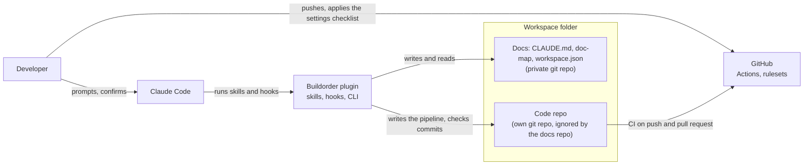

# Buildorder

A Claude Code plugin that sets up a workspace and engineering standards for your project.

[](https://github.com/PhilippKlinger/buildorder/actions/workflows/ci.yml)
[](https://scorecard.dev/viewer/?uri=github.com/PhilippKlinger/buildorder)
[](LICENSE)

Your agent writes the code. Buildorder builds the engineering around it.



## Contents

- [Requirements](#requirements)
- [Installation](#installation)
- [Quickstart](#quickstart)
- [How it differs from `/init`](#how-it-differs-from-init)
- [What you get](#what-you-get)
- [What CI checks](#what-ci-checks)
- [Security model](#security-model)
- [Limits and safety](#limits-and-safety)
- [License](#license)

## Requirements

- Claude Code
- Node.js 22 or newer
- git
- `gh` (optional)

## Installation

```text
/plugin marketplace add PhilippKlinger/buildorder#v1.0.0
/plugin install buildorder@buildorder
```

`#v1.0.0` pins the marketplace to that release tag; without it, the marketplace follows `main`.
Install the plugin at user scope (the default of `claude plugin install`). To turn it off for one project,
disable it there with `/plugin` (project scope).

## Quickstart

Run `/buildorder:init` in an empty folder (new project in one of the five stacks below) or in a folder that holds one existing git repo.
It does the following:

1. Checks the folder and runs a short interview (at most 8 questions).
2. Shows the plan and writes only after your confirmation.
3. Creates the workspace (a private git repo for the docs) with its doc-map and the GitHub settings checklist.
4. New project: writes the standard pipeline and a tested starter into the repo in one commit.
   Existing project: leaves the repo unchanged and turns missing items into backlog tasks.
5. Pushes nothing.

**Options:** the modules `versioning` and `web-quality` are options (class `option`). You choose them in the init or add them with `--with <module>` on the init command line.

If you run it inside the existing repo itself, init offers to move the repo into a subfolder first, so the
folder can become the workspace; it moves nothing without your OK. Afterwards, open a new session so the hooks
load, and start with `/buildorder:kickoff`. After updating the plugin, run `/buildorder:sync` to bring the
workspace files up to the installed version, and `/buildorder:radar` to see what is new in Claude Code.

## How it differs from `/init`

Claude Code's built-in `/init` reads the codebase and writes a `CLAUDE.md` for it. `/buildorder:init` writes a
`CLAUDE.md` too, but into a workspace folder next to the code repo, together with docs for handoff, sprint,
backlog, decisions and assumptions, kept in a private git repo of their own. For a new project it also writes a CI
pipeline and a tested starter for the chosen stack into the code repo; for an existing project it records what is missing
as backlog tasks. Inside the workspace, hooks guard commits and control files, and the skills start and end each
session from these docs.

## What you get

**Skills**

| Skill | Purpose |
|---|---|
| `/buildorder:init` | Guided workspace setup |
| `/buildorder:kickoff` | Session start: warnings, last handoff, repo state, task proposals |
| `/buildorder:handoff` | Session end: git state, docs update, handoff file |
| `/buildorder:assess` | Static assessment of one repo, findings ranked P0 to P3 |
| `/buildorder:review` | Code review with the project's own criteria (reports only) |
| `/buildorder:secure` | Security and data protection audit (reports only) |
| `/buildorder:scout` | Sharpens a plan before building: names blind spots, asks one question at a time, writes a brief or spec with acceptance criteria; with Superpowers installed, Superpowers generates the brief and `scout` checks it |
| `/buildorder:web-quality` | Static check of a web frontend for performance, SEO and accessibility; needs the `web-quality` module; reports only |
| `/buildorder:deploy-gate` | Go/no-go check before a deploy (clean pushed state, CI of HEAD, production compose file, variables); needs the `docker-cicd` module; reports only, never deploys |
| `/buildorder:deps` | Triage of open Dependabot pull requests: release notes, CI state, merge order; reports only, merges nothing |
| `/buildorder:ci-fix` | Diagnoses failed GitHub Actions runs: names job, step and log line, proposes a fix branch; applies nothing |
| `/buildorder:sync` | Lists what the installed templates would add or update in `CLAUDE.md` and the doc-map; writes after your OK and never overwrites a file you changed |
| `/buildorder:radar` | Reads the official Claude Code sources for news since the last run and proposes at most three changes; changes no files except the run date in `.claude/workspace.json` |

**Hooks**

- Boundary guard: keeps workspace control files out of code repos.
- Secret guard: scans the staged diff before `git commit` and denies on findings.
- Prompt hints: adds keyword hints and suggests `/effort high` for debugging, security or release work.
- Compaction guard: after a compaction, asks to re-sync from the handoff before continuing.
- Handoff reminder: when commits are newer than the handoff file.
- Version drift: on release prompts, warns when the latest tag and the version files disagree (`versioning` module).

**Stacks:** five modules, each with CI jobs and a tested starter.

| Stack | CI jobs |
|---|---|
| `django` | ruff, pytest with coverage against PostgreSQL, `manage.py check --deploy` and `collectstatic`, pip-audit |
| `python` | ruff, pytest with coverage, `python -m build`, pip-audit (a library starter) |
| `go` | golangci-lint, `go test -race` with coverage, `go build`, `go mod verify`, govulncheck |
| `react` | eslint, `tsc`, prettier, vitest with coverage, `vite build`, `npm audit` |
| `angular` | `ng lint`, prettier, `ng test --coverage`, `ng build`, `npm audit` |

Other stacks get the workspace and the stack-independent CI only. The Django and Go starters expose a health
endpoint (`/healthz/` and `/healthz`) with a test; the Django starter has neither `auth` nor `admin`.

**Deploy targets:** `container`, `paas`, `webspace` or `none`. The container image (Trivy scan, SBOM,
build-provenance attestation) and its CD come from the `docker-cicd` module.

## What CI checks

**The pipeline Buildorder writes** into a new repo is one `ci.yml` that runs on pushes to `main`, on pull
requests and on demand. Its `ci-ok` job is the required check of the ruleset in the settings checklist.

- Stack jobs: lint, tests with coverage, build and dependency audit of the chosen stack (see the table above).
- gitleaks over the full history, zizmor over the workflows, and the pre-commit hooks.
- Dependency Review on pull requests and CodeQL for the stack's language and for GitHub Actions, in public repos
  only: for a private repo both jobs are left out and recorded as a deviation (see
  [Limits and safety](#limits-and-safety)).
- Every action pinned to a full commit SHA; Dependabot keeps the pins and the stack's dependencies current.
- With the `docker-cicd` module: image build, Trivy scan (CRITICAL and HIGH with a fix available), SPDX SBOM, and
  on `main` a push to GHCR by digest with a build-provenance attestation (public repos). CD for `container` and
  `webspace` runs only once the repository variable `DEPLOY_ENABLED` is `true`.

Trivy runs as the pinned `aquasecurity/trivy-action`; together with the SBOM step (`anchore/sbom-action`) it is one of
the only two actions in this pipeline not published by GitHub; zizmor and gitleaks run as pinned tool versions (pipx,
and a container image pinned by digest).

**Buildorder's own CI** (`.github/workflows/ci.yml`) runs on pushes to `main`, on pull requests, weekly and on
demand; `ci-ok` requires every job to succeed.

- `test`: the full test suite and the hook timing test on Ubuntu, Windows and macOS with Node 22 and 24.
- `validate`: `claude plugin validate --strict` for the marketplace and the plugin.
- `pre-commit`: the repo's pre-commit hooks.
- `template-pins.yml` (separate workflow): lists the actions used in the templates and lets Dependabot keep them current; `node scripts/template-pins.mjs --write` copies them into the templates.
- `zizmor`: zizmor over this repo's workflows and over the workflows `standard` generates, then actionlint over
  the generated ones.
- `django-fixture`, `python-fixture`, `go-fixture`, `react-fixture`, `angular-fixture`: each writes that stack's
  starter and pipeline into an empty repo and runs the pipeline's core steps on it: lint, tests with coverage,
  build checks, dependency audit and, where the stack has an image, image build and Trivy.
- `gitleaks`: `gitleaks/gitleaks-action`; pull requests scan their commits; the weekly and manual runs scan the full
  history.
- `codeql`: CodeQL for JavaScript and GitHub Actions.

actionlint runs from its official release archive, pinned by version and SHA-256, because no pinned action checks
the generated workflows in the same job. A separate `scorecard.yml` runs OpenSSF Scorecard on pushes to `main`,
weekly, and publishes the result; it rates the repo and is not part of `ci-ok`.

**Releases.** The release workflow builds the archive from the tagged commit and attaches a build-provenance
attestation. Verify a downloaded archive with
`gh attestation verify buildorder-<tag>.tar.gz --repo PhilippKlinger/buildorder --signer-workflow PhilippKlinger/buildorder/.github/workflows/release.yml`.
Only the archive attached to the release is attested; GitHub's automatic source archives are not.

## Security model

The hooks are guardrails, not a guarantee. They catch common mistakes in the commands an agent runs; a command
written to get around them gets around them, and they are no sandbox. Permissions, `settings.json` and the sandbox
stay your decision: Buildorder writes no Claude Code settings file. The hooks act only inside a Buildorder
workspace (a folder with `.claude/workspace.json` at or above the path); elsewhere they stop after that lookup.

**Boundary guard** (Write and Edit tool calls). It denies a doc-map file (the names in `guards.docsOnlyNames`)
at the root or in `docs/` of a code repo, and any path in `guards.protectedPaths`. It does not see files that a
shell command writes, and files with the same name deeper in a repo, such as templates, are allowed.

**Secret guard** (`git commit` through the Bash or PowerShell tool). It scans the added lines of the staged and
unstaged changes of tracked files, and the untracked files when a `git add` runs before the commit in the same
command. It flags secret files by name (`.env`, private keys, `*.pem` and similar) and a fixed list of patterns
(private keys, AWS, GitHub, Slack and Google keys, `sk-` API keys, Django `SECRET_KEY`, quoted passwords and
tokens), and shows the findings masked. It fails closed: when git output cannot be read, or the command does not
show which repo the commit goes to, the commit is denied with a hint for a form it can read.

Known limits:

- The `if: Bash(git *)` filter does not see `/usr/bin/git`, `git.exe` or `sh -c`.
- Shell aliases, git aliases and disguised commands are not recognised.
- Only `commit` is scanned, not `merge`, `cherry-pick` or `am`, nor tools that commit without the word `git`.
- A secret assigned without quotes (`DB_PASSWORD=value`) is not found, and a value that contains a placeholder
  word such as `example` or `your_` is ignored.
- `onFailure: block` needs `node`: without it, every `git` command through these tools is denied in every project
  where the plugin is enabled.
- Commits made outside Claude Code are not seen; the pre-commit gitleaks hook and the CI gitleaks job cover those.

## Limits and safety

- Buildorder never pushes and never creates repositories. `/buildorder:init` does not call the GitHub API:
  GitHub settings are a checklist with ready commands that you run.
- `/buildorder:deploy-gate`, `/buildorder:deps` and `/buildorder:ci-fix` make read-only `gh` calls, each after your
  permission. For a failed run, excerpts of the CI log enter the model's context.
- No telemetry. Data leaves your machine only when `/buildorder:radar` fetches the fixed public Claude Code pages
  (WebFetch) and through the `gh` commands of `/buildorder:deploy-gate`, `/buildorder:deps` and `/buildorder:ci-fix`, each after your permission.
- Hooks are guardrails, not a guarantee; see [Security model](#security-model) for what they do and their known
  limits.
- Private repos skip CodeQL and Dependency Review (paid GitHub products: GitHub Code Security, which GitHub offers only
  for organization-owned repos on Team or Enterprise Cloud) and record this as a deviation.
- A repo with several stacks gets the CI block of one stack; the others are named in the plan as not covered, and you
  add their checks to `ci.yml` by hand.
- Behind a reverse proxy that terminates TLS, set `DJANGO_BEHIND_PROXY=true` for the Django starter.

## License

MIT, see [LICENSE](LICENSE). Security reports: see [SECURITY.md](SECURITY.md).
